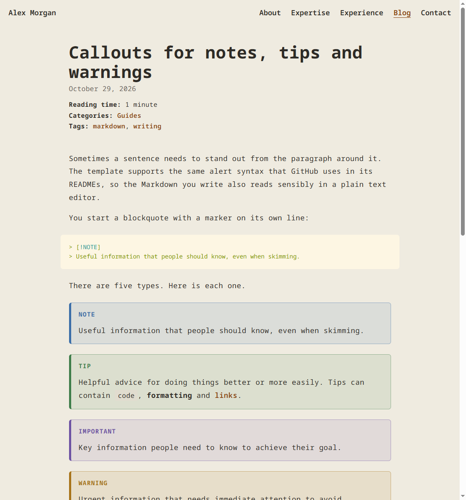

# plain-blog: a minimal Astro blog template with zero JavaScript

[](https://github.com/DamianMog/plain-blog/actions/workflows/ci.yml)
[](LICENSE)
[](https://astro.build)


[](https://demo.mikrus.dev)

**plain-blog** is a free, open-source blog and personal website template for [Astro](https://astro.build). You write Markdown, the build produces plain static HTML and CSS, and any web server can host the result. No trackers, no ads, no cookies and no client-side JavaScript.

[**Live demo**](https://demo.mikrus.dev) · [Quick start](#quick-start) · [Features](#features) · [Writing posts](#writing) · [Deploying](#deploying) · [Inspiration](#inspiration)

| Light mode | Dark mode |
| --- | --- |
|  |  |

The design is inspired by the personal site and blog of [Luciano Nooijen](https://lucianonooijen.com/): a warm, monospaced, text-first layout. See [Inspiration](#inspiration).

## Why plain-blog?

- **Fast.** A typical post, including its code highlighting and self-hosted font, weighs under 50 KB transferred.
- **Private.** No analytics, no third-party requests, no consent banner needed.
- **Durable.** The output is HTML and CSS, so it keeps working long after today's frameworks have moved on.
- **Easy to own.** Posts are Markdown files in Git. There is no database and no admin panel to maintain.
- **Complete enough.** Categories, tags, RSS, sitemap, dark mode, syntax highlighting and SEO metadata are included, so you can start writing on day one.

Good for personal blogs, developer portfolios, project documentation notes and digital gardens.

## Features

- **Pages and posts as Markdown.** Home, About, Expertise, Experience, Contact and a blog, all editable as plain files.
- **Categories and tags**, with overview pages and a page per term.
- **Reading time**, previous/next post links and an optional table of contents per post.
- **Syntax highlighting** at build time with separate light and dark themes ([Shiki](https://shiki.style)).
- **Callouts** using GitHub's alert syntax (`> [!NOTE]`, `TIP`, `IMPORTANT`, `WARNING`, `CAUTION`).
- **GitHub-flavoured Markdown**: tables, task lists, footnotes, strikethrough.
- **Dark mode** that follows the visitor's system setting, with no toggle script.
- **Drafts and updated dates** in the front matter.
- **RSS feed**, **sitemap**, canonical URLs and Open Graph tags.
- **Print stylesheet** that strips navigation and switches code to black on white.
- **Mobile navigation without JavaScript** (CSS only).
- **Self-hosted font.** No requests to third parties, no trackers, no cookies.
- **Deploy script** (`tar` + `ssh`, atomic release switch) and an example Nginx config.

## Quick start

Requires Node.js 22.23.4 or newer.

```bash
git clone https://github.com/DamianMog/plain-blog.git my-blog
cd my-blog
npm install
npm run dev
```

Open http://localhost:4321. Production build:

```bash
npm run build      # output goes to dist/
npm run preview    # serve dist/ locally
```

## Make it yours

Everything personal lives in one file, [`site.config.ts`](site.config.ts): site title, tagline, description, navigation, social links, footer text and the number of posts on the home page.

Set the public URL at build time so the feed, sitemap and canonical links are correct:

```bash
SITE_URL=https://example.com npm run build
```

Also update the `Sitemap:` line in `public/robots.txt`.

The colour palette and typography are CSS variables at the top of [`src/styles/global.css`](src/styles/global.css).

## Writing

```
src/content/
  blog/     one Markdown file per post
  pages/    About, Expertise, Experience, Contact (one Markdown file each)
```

A post starts with front matter:

```yaml
---
title: My first post
description: One sentence for search results and link previews.
pubDate: 2026-01-31
updatedDate: 2026-02-10   # optional
categories: [Guides]
tags: [writing, tips]
toc: true                 # optional table of contents
draft: true               # optional, hidden from production builds
---
```

The file name becomes the URL: `src/content/blog/my-first-post.md` is served at `/blog/my-first-post/`.

To add a page to the navigation, create a file in `src/content/pages` and add a matching entry to `nav` in `site.config.ts`.

Static files such as images go in `public/` and are referenced from the site root, for example ``.

## Project layout

```
site.config.ts            site-wide settings
astro.config.mjs          Astro, Markdown and syntax highlighting setup
src/
  content.config.ts       front matter schema for posts and pages
  content/                your Markdown
  components/             header, footer, post list
  layouts/BaseLayout.astro
  pages/                  routes: home, blog, categories, tags, RSS, 404
  plugins/rehype-alerts.mjs   callout blocks
  styles/global.css       all styling
  utils/posts.ts          sorting, grouping, reading time
public/                   favicon, robots.txt, images
scripts/deploy.sh         upload dist/ to a server over SSH
deploy/nginx.conf.example example Nginx server block
```

## Deploying

The build output is a folder of static files, so any static host works (Nginx, Caddy, Netlify, GitHub Pages, S3, ...).

To deploy to your own server over SSH:

```bash
DEPLOY_HOST=example.com \
DEPLOY_USER=deploy \
DEPLOY_PATH=/var/www/my-blog \
npm run deploy
```

[`scripts/deploy.sh`](scripts/deploy.sh) uploads `dist/` as a new release directory and atomically switches a `current` symlink to it, keeping the last five releases for rollback. It only needs `bash`, `tar` and `ssh` locally and `tar` on the server.

Point your web server's document root at `<DEPLOY_PATH>/current`. A ready-to-adapt Nginx server block is in [`deploy/nginx.conf.example`](deploy/nginx.conf.example). The demo walkthrough is also available as a post on the [demo site](https://demo.mikrus.dev/blog/deploy-to-your-own-server/).

## Scripts

| Command | What it does |
| --- | --- |
| `npm run dev` | Development server with live reload (drafts visible) |
| `npm run build` | Production build into `dist/` |
| `npm run preview` | Serve the production build locally |
| `npm run deploy` | Build and upload with `scripts/deploy.sh` |

## Notes on the demo content

The demo site's author, employers and links are fictional placeholder content. Replace the files in `src/content` and the values in `site.config.ts` with your own.

## Inspiration

This template is inspired by [lucianonooijen.com](https://lucianonooijen.com/), the personal site and blog of Luciano Nooijen, a freelance software engineer. Several ideas come from there: the monospaced typeface on a warm paper background, the minimal navigation (About, Expertise, Experience, Blog, Contact), the blog index with categories, reading time and tags, and the principle that a website should be simple, content-first and free of trackers and ads.

It is not a copy or a fork. The original site is built with Hugo and its source is published under AGPL-3.0, while everything in this repository (code, styles and demo content) was written from scratch for Astro and is released under the MIT license. If you like this style, go and read the original blog.

## License

[MIT](LICENSE)
